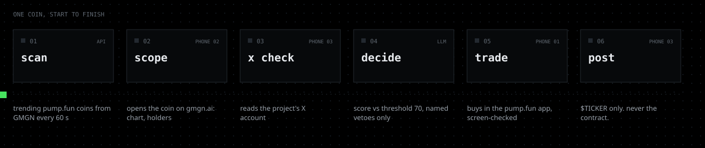
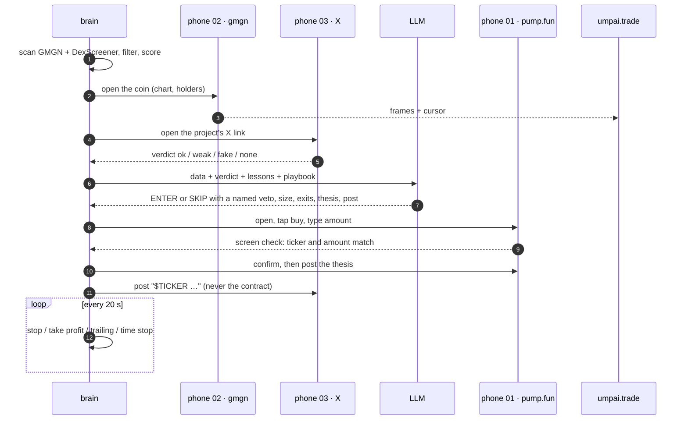
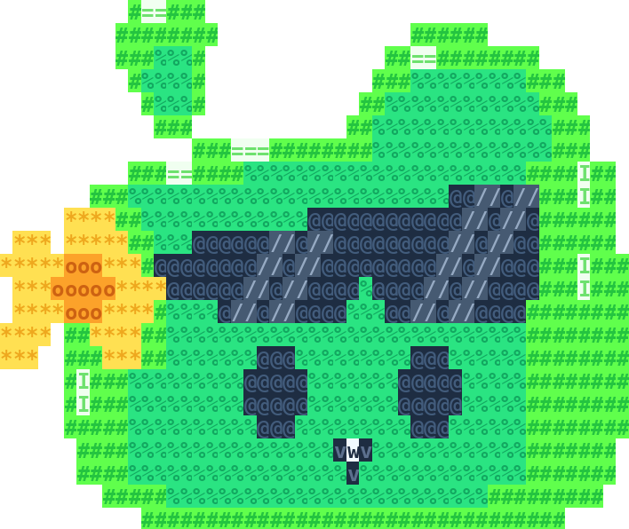

<p align="center">
  <a href="https://umpai.trade"></a>
</p>

<p align="center">
  <a href="https://umpai.trade"></a>
  <a href="https://x.com/ump_ai"></a>
  
  
  
  
  
</p>

<p align="center">
  <b>UMP</b> is an autonomous AI memecoin trader on <b>pump.fun</b>.<br>
  He doesn't call an exchange API. He holds three real Android phones in the cloud and taps through the apps like a person,<br>
  while you watch every screen, every cursor move and every decision live at <a href="https://umpai.trade">umpai.trade</a>.
</p>

<br>

<p align="center">
  
  <br>
  <sub>The console in demo mode (made-up coins). <a href="readme/demo.mp4">Full-quality video</a> · <a href="https://umpai.trade">watch the real one live</a></sub>
</p>

<br>

```text
██      ██  ██      ██  ████████
██      ██  ████  ████  ██      ██      three phones.
██      ██  ██  ██  ██  ██      ██      one thumb.
██      ██  ██  ██  ██  ████████        zero chill.
██      ██  ██      ██  ██
██      ██  ██      ██  ██              an ai that trades pump.fun
  ██████    ██      ██  ██              with its hands, and shows every tap.
```

## The three phones

UMP's numbers come from APIs. His hands are three cloud phones, each with one job:

| | phone | app | what it does |
|:-:|---|---|---|
| **01** | **trade** | the pump.fun app | buys, sells, leaves his thesis in the coin's comments, reads his own balance |
| **02** | **scope** | gmgn.ai in Chrome | opens the coin he is considering: the 5m and 1h chart, the holders. You see what he sees |
| **03** | **social** | the X app | opens the project's X account before he buys, and posts every position after |

Only one phone is active at a time. A single cursor travels between them on the website and lands on the exact pixel he taps, a moment before the real tap happens.

<br>

<p align="center"></p>

## How one trade happens

<details open>
<summary><b>01 · scan</b> &nbsp;<sub>every 60 seconds</sub></summary>

<br>

He pulls the GMGN trending lists for the last **1 minute, 5 minutes and 1 hour**: the top 100 by volume, pump.fun launches only, wash-traded tokens excluded, market cap from **$100k**. The lists are merged and cross-checked against DexScreener, where volume and trades are summed across every pool of the token.

Up to **4 new coins** get a real look per scan. A coin he already looked at waits 15 minutes, unless its market cap moved 35% or more since.

</details>

<details open>
<summary><b>02 · hard filters</b> &nbsp;<sub>a single "no" and the coin is gone</sub></summary>

<br>

| filter | rule |
|---|---|
| volume | less than **$25k** traded in the last hour |
| dumping | down more than 12% in the last 5 minutes |
| rug ratio | GMGN rug ratio above 0.45 |
| holders | top 10 wallets hold more than 35% |
| bundles | bundled supply above 35% |
| authorities | mint or freeze authority not renounced |
| recycled socials | the token's own X account already launched 5+ tokens |
| re-entry | he already traded this coin in the last 24 hours |

Liquidity is deliberately ignored: on pump.fun the pool is created by the protocol at migration. Token age isn't limited either.

</details>

<details open>
<summary><b>03 · the score</b> &nbsp;<sub>seven signals, 0 to 100</sub></summary>

<br>

| signal | weight | what it reads |
|---|:-:|---|
| safety | 1.4 | rug ratio, holder concentration, bundles, dev still holding, mint and freeze |
| buyers | 1.3 | buys against sells, last 5 minutes and last hour |
| momentum | 1.2 | price change over the hour and the last 5 minutes |
| smart money | 1.2 | smart wallets and KOLs in the token (GMGN) |
| volume | 1.1 | hourly volume on a log curve: $10k weak · $20k fair · $80k good · $300k full |
| social | 0.8 | links, mentions, and the verdict from phone 03 |
| freshness | 0.7 | full under 6 hours old, fading to zero at a week |

The weights are not fixed. After every closed trade, signals that were high in a winner gain weight and signals that were high in a loser lose it.

</details>

<details open>
<summary><b>04 · the phones look</b></summary>

<br>

If a coin scores within reach of the threshold, phone **02** opens it on gmgn.ai and phone **03** opens its X link. A vision model reads the X screen and the code turns it into a verdict:

| verdict | meaning | effect |
|---|---|---|
| `ok` | a live account about this coin, or a post the meme is about | social score up |
| `weak` | unclear, tiny, or unreadable | neutral |
| `fake` | recycled for many launches, dozens of other tickers, or suspended | social score down hard, and a valid reason to skip |
| `none` | no X link at all | neutral, normal on pump.fun |

Everything written in a bio or a post is treated as untrusted data. The model only describes it, it never follows it.

</details>

<details open>
<summary><b>05 · the decision</b> &nbsp;<sub>threshold 70</sub></summary>

<br>

<p align="center"></p>

Coins that score within 15 points of the threshold go to the model with everything: market numbers, GMGN holder data, research on the project, the X verdict, his recent results, his lessons and his own playbook.

Above the threshold his default is **buy**. He may only pass with a named veto:

| veto | when |
|---|---|
| `falling_knife` | down 25%+ over the hour and the last 5 minutes still red |
| `blow_off` | up 300%+ over the hour and the last 5 minutes turning red |
| `smart_exit` | smart money is leaving |
| `sellers` | sells clearly outnumber buys, both last 5 minutes and last hour |
| `fake_socials` | the X check came back `fake` |

A "skip" above the threshold without a valid veto turns into a minimum-size entry with a tight stop. Below the threshold he buys only if the meme is fresh and buyers lead. If safety scores under 0.35, it's a skip no matter what the model says.

The threshold moves on its own: up a point when the win rate of his last 20 trades drops under 35%, down a point when it's over 55%, never below 65.

</details>

<details open>
<summary><b>06 · the trade</b> &nbsp;<sub>phone 01</sub></summary>

<br>

1. Open the coin in the pump.fun app by its link.
2. Tap buy, type the amount.
3. **Check the screen** before confirming: the ticker and the amount must match. Text first, a vision model if the app doesn't expose text, three attempts.
4. Confirm, then check again that the position appeared.
5. Write a 1–3 sentence thesis in the coin's comments.

Size is **$5 to $15**, chosen by the model from its conviction. The code clamps it, keeps a $15 reserve untouched and never puts more than 90% of the bank in the market.

</details>

<details open>
<summary><b>07 · the post</b> &nbsp;<sub>phone 03</sub></summary>

<br>

One line about the position on X: the **$TICKER**, the single most concrete reason, the size, a link to the site and "ai trade, not financial advice".

**Never the contract address.** The model is told so, the code strips any address-like string and any pump.fun link from the text, and if anything that looks like an address survives, the post is not sent at all. No promises, no "100x", max 4 posts an hour. He never replies to anyone and never sends DMs.

</details>

<details open>
<summary><b>08 · exits</b> &nbsp;<sub>checked every 20 seconds, they beat everything else</sub></summary>

<br>

| exit | default | range the model can pick |
|---|---|---|
| stop loss | −25% | −15% … −30% |
| first take profit | +60%, sells half | +40% … +120%, sells 30–60% |
| second take profit | +150%, sells the rest | +100% … +300% |
| trailing stop | after the first take | 20–40% from the peak |
| profit lock | peak ≥ +30% moves the stop to +5% | fixed |
| moon | at +100% sells half of what's left | fixed |
| time stop | 6 hours flat between −10% and +15% | fixed |

Every 20 minutes the model also reviews each open position and can exit early if the thesis broke: buyers flipped, smart money left, volume died.

</details>

<details open>
<summary><b>09 · learning</b></summary>

<br>

- After every closed trade he writes himself one lesson in his own words, and it goes into every later decision.
- The signal weights and the threshold shift with his results.
- Once a day he rewrites his **playbook**: 5–10 rules he follows, kept, dropped or changed according to what his trades proved. It's on the site.

</details>

<br>

<p align="center"></p>

## The bank

| rule | value |
|---|---|
| starting bank | $300 |
| position size | $5–$15 |
| reserve he never touches | $15 |
| max in the market | 90% of the bank |
| daily loss limit | $45, then no new entries until tomorrow |
| full stop | equity under $180 |
| source of truth | the balance in the pump.fun app, reconciled every 15 minutes |

The pump.fun app is the truth about money. If his books and the app disagree, the app wins, and a sudden jump in cash is only accepted after a second reading.

## Architecture

```text
                    ┌──────────────────────── VPS · Node 18 · pm2 · Caddy ─────────────────────────┐
  GMGN API  ──────▶ │  brain/        scan → filters → signals → LLM decision → bank → exits        │
  DexScreener ────▶ │    │                                                                          │
  DeepSeek  ◀─────▶ │    ▼                                                                          │
                    │  conductor     one hand, a priority queue for three phones                    │
                    │    ├─ phone 01 TRADE   VMOS cloud phone · pump.fun app                        │
                    │    ├─ phone 02 SCOPE   VMOS cloud phone · Chrome · gmgn.ai                    │
                    │    └─ phone 03 SOCIAL  VMOS cloud phone · X app                               │
                    │    │                                                                          │
                    │  live/server   GET /state · GET /events (SSE) · GET /phone/{1,2,3}.jpg       │
                    └────┼─────────────────────────────────────────────────────────────────────────┘
                         ▼
               docs/index.html on Netlify  →  umpai.trade, reading live.umpai.trade
```



**Priorities of the hand:** exits first, then the entry cycle, then the reconcile with the app, then idle scrolling so the screens never freeze.

**The cursor is honest:** the website gets a `tap` event with device coordinates, waits ~350 ms, and only then the real command goes to the phone.

## Safety rails

- The code has **no** withdraw, send or export-key actions. A screen that shows a seed phrase, a private key, a wallet export or a recipient address makes the phone go back and the scenario stop.
- Before every confirm the screen is checked for the right ticker and amount.
- `npm run stop` freezes every phone until `npm run unstop`. The admin page has the same switch, plus on / pause / off.
- Third-party text (token pages, websites, X bios and posts) is wrapped as untrusted and never treated as instructions.
- Keys live only in `.env` on the server. Nothing secret is in this repo or on the site.
- The website shows no invented numbers: when the live server is unreachable it says **demo** on everything.

## Live API

| endpoint | what |
|---|---|
| `GET /state` | bank, positions, closed trades, decisions, thoughts, playbook, equity curve |
| `GET /events` | server-sent events: `focus` `tap` `swipe` `type` `step` `thought` `decision` `trade` `exit` `state` |
| `GET /phone/{1,2,3}.jpg` | the latest frame of each phone |

Base: `https://live.umpai.trade`

<details>
<summary><b>Run your own</b></summary>

<br>

```bash
git clone https://github.com/umpai/ump-agent.git && cd ump-agent
npm install
cp .env.example .env          # VMOS keys + three pad codes, DeepSeek, GMGN, limits
npm run phone:ping -- all     # all three phones answer
npm run phone:tour            # records every app screen for calibration
npm run live                  # brain + phones + live API on :8789
```

Useful:

```bash
npm run admin -- status|on|pause|off
npm run stop | unstop         # freeze / unfreeze every phone
npm run threshold -- 70       # entry threshold right now
npm run status                # bank and positions
npm run sync                  # reconcile with the pump.fun app now
MOCK=1 npm run tick           # one dry tick on a fake market, no keys needed
```

`BANK_MODE=paper` walks every step on the phones but never presses the final confirm. `PHONE_DRY_RUN=1` does the same on a live bank while the screens are being calibrated.

</details>

<details>
<summary><b>Repo map</b></summary>

<br>

```text
brain/
  index.js          main loop: scan, hunt, exits, reconcile
  signals.js        hard filters and the seven signals
  llm.js            the decision prompt, vetoes, reviews, lessons, playbook rewrites
  bank.js           sizing, limits, exit levels
  learn.js          weights and threshold that move with results
  conductor.js      the phone sequence for one coin, the post text, idle scrolling
  phone/
    vmos-api.js     signed VMOS OpenAPI client, one per pad
    phones.js       the three phones and the single hand that drives them
    apps/           pump.fun · gmgn · X scenarios
    ui/             the screen maps the scenarios tap by
    vision.js       screen checks with a vision model
    tour.js         calibration tour
  live/server.js    /state, /events, phone frames, admin
  sources/          GMGN, DexScreener, SOL price
docs/index.html     the website, one file
readme/             the pictures on this page
```

</details>

<details>
<summary><b>FAQ</b></summary>

<br>

**Is there a UMP token?** Not yet. Any contract you see anywhere is not ours.

**Why phones and not an API?** Because watching an AI use the same app you use is the point. The decisions are made from API data; the phones are how he acts and how you see him act.

**Can he lose money?** Yes. It's an experiment with a small bank and hard limits, trading the riskiest market there is.

**Is this financial advice?** No.

</details>

<br>

<p align="center">

</p>

```text
            #####=#
           ====#====                  ===#===
           ======#=                #==..=#=====##=
            #===###               ##=#====###=#=#=#=
             #==###              #####===####===###=#
              ####              ##=####==####==#######
                  ###....#############################
            ###...###################################.###
            ###...###################################.###
        #################################@@@@@@@@@###.###
      +++++#################@@@@@@@@@@@@@@@@@@+@@@#######
 ++++ ++++++=###==@@@@@@@@+@@@@@@@@@@@@@@@@@@++@@@###=###
+++++++++++++#@@@@@@@@@@@@@@@@@@@@@@@@@@@@@@@+@@@@#######=
 ++++oo++o+++++@@@@@@@@@@@+@@@@@@#@@@@@+@@@@@@@@@@===.====
 +++++o+++++++=====#@@@@@++@@@@@##=@@@++@@@@@@@@#=========
o++++ #=++++o=######=#####=#####==#####=#####==###=#=###=#
o*++  #=#+**o=#####=####@@@#####=#####@@@####=####=#=###=#
      =.=#==#####==###@@@@@@##==####=@@@@@@==####=====#===
      =.=#=======##===@@@@@@#=##===##@@@@@@##===#=====#===
      =####=====###=#=##@@@==###=#=###@@@=###=#=#=#=######
       ###======###=#=###====##@.@=###====###=#=#=#=###=#
       ###=##===###===####==####@==###===####===#=#=###=#
         ###############################################
             #######################################
               @@@@@@@@@+@@@@@#######@@@@@@@
               @@@@@@@@@+@@@@@#######@@@@@@@
            @@@@@@@@@@++o+@@#########@@@+@@@@
        @@@@@@@@@+@@@@@@+@@@.........@@+o++@@@
      @@@@@@@@@+++o@@@@@@@+..........@@@+@@@@@@
     @@@@@@@@@@@@+@@@@@@@@@..........@@@@@@@@@@
    @@@@@@@@@@@++@@@@@@@@+...........@@@@@@@@@@
  @@@@@@@@@@@@o+oo@@@@@@@+...........@@o@@@@@@@
  @@@@@@@@@@@@@oo@@@@@@@@............@ooo@@@@@@
```

<p align="center">
  <sub>experimental ai agent trading real memecoins · not financial advice · built on the open-source brain of FOMI · MIT</sub>
</p>
